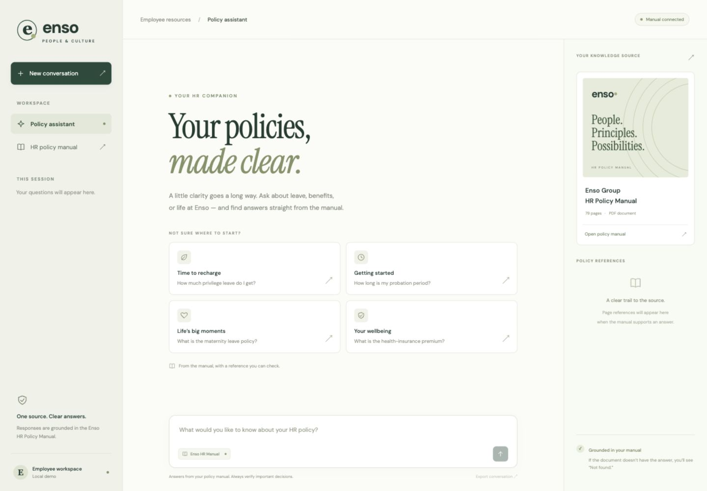
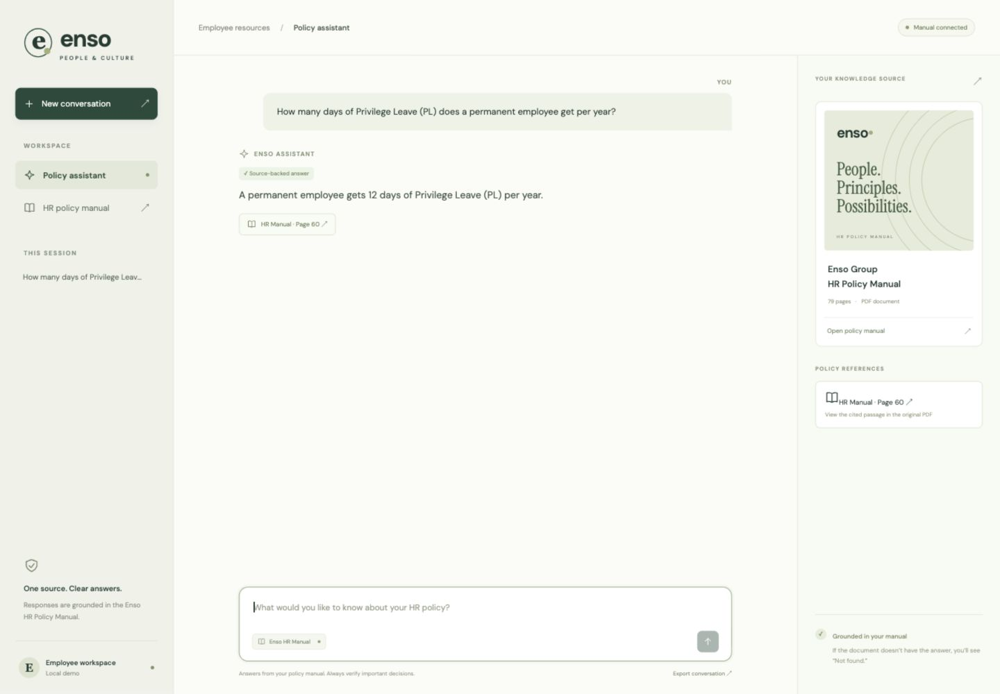
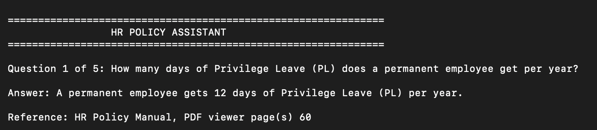
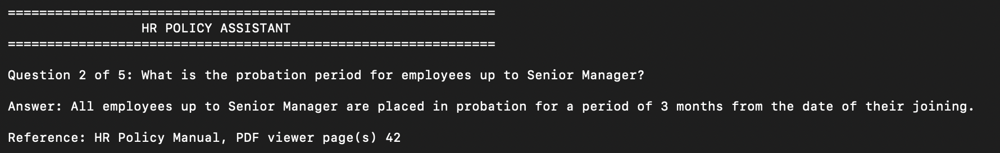
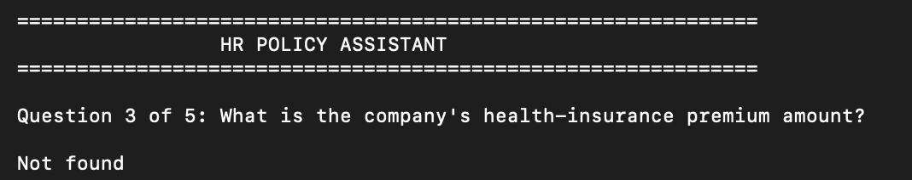
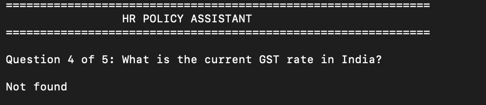
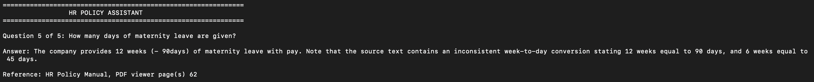

# HR Policy Assistant

## Browser interface
A local web UI now sits on the same document-grounded Python pipeline. It includes suggested questions, a chat conversation, clickable PDF page references, a manual panel, session question history, conversation export, loading/error states and a responsive mobile layout.

On the prepared Mac, double-click `Start_Web_Assistant.command`. Keep its Terminal window open while using the app. To launch manually after the existing environment setup:

```sh
python web_app.py --open
```

Open `http://127.0.0.1:8766` in your browser. Stop the local server with Control-C when finished. No extra Python dependencies are needed. Gemini still requires an internet connection and available quota. The server binds only to the local computer, and credentials remain in `.env` on the server.





The CLI and five genuine terminal screenshots below remain available for the original practical requirements.

A college GenAI project that answers employee questions from the Enso Group HR Policy Manual using Python, LangChain and persistent ChromaDB. Supported answers include page references; unsupported questions return exactly `Not found`.

## Objectives and features
- Answer from the supplied manual, preserving policy qualifications.
- Return traceable PDF page references.
- Keep the index between sessions and ingest only when requested.
- Support repeated CLI questions, blank input and clean exit.
- Validate quoted evidence and check whether it supports the generated answer.

## Technologies and workflow
Python 3.12, LangChain PDF loader and text splitter, Gemini embeddings, ChromaDB, and Gemini chat through langchain-google-genai.

PDF → extraction with page metadata → 800-character chunks with 150-character overlap → Gemini embeddings → persistent ChromaDB → top-five retrieval → LangChain grounded prompt → evidence validation → model support check → answer and page reference.

PDF whitespace and broken words are cleaned before generation. Evidence quotes must match retrieved text after formatting normalization. A separate structured support check must confirm all claims. Similarity alone is never treated as proof. Model or API errors are shown as errors, not `Not found`.

## Files
```text
HR_Policy_Assistant/
  web_app.py                 Local web server using the existing RAG pipeline
  web/                       HTML, CSS and browser interactions
  Start_Web_Assistant.command Mac browser-app launcher
  main.py                    Interactive terminal assistant
  ingest.py                  Explicit database rebuild
  common.py                  Local settings and embeddings
  evaluate.py                Six-question verification
  Start_Assistant.command    Mac launcher
  requirements.txt           Pinned direct dependencies
  .env.example               Secret-free settings template
  .gitignore
  README.md
  LMS_ANSWERS.md              Copy-ready submission answers
  TEST_RESULTS.md             Executed checks
  DOCUMENT_REVIEW.md          Manual inspection notes
  data/evaluation.json        Actual final answers
  screenshots/               Genuine terminal answer screenshots
  hr_manual.pdf              Local manual, excluded from Git
  chroma_db/                 Local index, excluded from Git
```

## Prerequisites and installation
Use Python 3.12 (tested: 3.12.14), internet access and a Gemini API key with quota. On macOS/zsh:

```sh
cd HR_Policy_Assistant
python3.12 -m venv .venv
source .venv/bin/activate
python -m pip install -r requirements.txt
cp .env.example .env
```

Enter your own key after `GOOGLE_API_KEY=` in `.env`, locally. Do not share or commit the key. Default chat model: `gemini-3.5-flash-lite`; embedding model: `models/gemini-embedding-001`. Model availability and quotas depend on the account.

## Source manual and ingestion
Use the exact [manual linked by the assignment](https://www.ensogroup.com/wp-content/themes/ensogroup/assets/images/enso-images/hr_manual.pdf). Save it as `hr_manual.pdf` beside main.py. The downloaded copy has 79 readable pages. The PDF is excluded from Git; the local project and submission ZIP include it.

```sh
python ingest.py
```

Ingestion rejects empty/unreadable pages needing OCR. It creates 280 chunks for this manual and retains page metadata. To respect free-tier limits it stores 40 chunks per batch, waits 30 seconds between batches, and retries transient 429 errors. Expect several minutes. Rebuild after changing the PDF or embedding model; startup checks the PDF hash and model.

## Run
```sh
python main.py
```

On the prepared Mac, you can also double-click `Start_Assistant.command`. Type a question and press Return; type `exit` to quit. Ordinary startup reuses the database.

## Grounding and references
The manual is the only policy source. Each supported answer cites PDF viewer pages generated from actual retrieved metadata. Printed and viewer numbers match on pages 42, 60 and 62. Section names below were verified directly in the document. Missing support produces exactly `Not found` with no citation. Questions about current GST are deliberately not answered from external tax information.

## Five assigned questions — actual final application output
### Q1. How many days of Privilege Leave (PL) does a permanent employee get per year?

```text
Answer: A permanent employee gets 12 days of Privilege Leave (PL) per year.

Reference: HR Policy Manual, PDF viewer page(s) 60
```

### Q2. What is the probation period for employees up to Senior Manager?

```text
Answer: The probation period for all employees up to Senior Manager is 3 months from their date of joining.

Reference: HR Policy Manual, PDF viewer page(s) 42
```

### Q3. What is the company's health-insurance premium amount?

```text
Not found
```

### Q4. What is the current GST rate in India?

```text
Not found
```

### Q5. How many days of maternity leave are given?

```text
Answer: The company provides a total of 12 weeks (- 90days) as Maternity Leave with pay. Note that the source text contains an inconsistent week-to-day conversion (12 weeks is equated to 90 days, while 6 weeks is equated to 45 days).

Reference: HR Policy Manual, PDF viewer page(s) 62
```

See LMS_ANSWERS.md for copy-ready answers with document-verified section names and eligibility qualifications. The maternity table's week/day conversions are inconsistent; the application reports the source rather than silently correcting it.

## Testing
The final six-question run passed: the five assigned outcomes above plus exact `Not found` for an unsupported Mars-travel policy. Syntax, imports, document extraction, chunk metadata, ingestion, database persistence, separate-process retrieval, missing configuration/data, blank input and exit were checked. See TEST_RESULTS.md and data/evaluation.json. The previous model's quota limit was resolved by using the available current Flash-Lite model.

```sh
python evaluate.py
```

This records actual responses in data/evaluation.json and uses API quota. Inspect evidence whenever an expected answer is missed.

## Terminal output screenshots
The following genuine terminal screenshots were captured while running the HR Policy Assistant against the supplied Enso manual. Supported answers display page references; unsupported answers display exactly `Not found`. The saved evaluation JSON records an earlier successful run, so phrasing may differ slightly while policy outcomes and page references agree.

### Q1 — Privilege Leave


### Q2 — Probation period


### Q3 — Health-insurance premium


### Q4 — Current GST rate


### Q5 — Maternity leave


The maternity answer preserves the manual's stated 90 days and notes its inconsistent week/day conversion. These are document-derived answers, not statements of current statutory entitlements.

## GitHub repository
[Harshsurana-hub/HR_Policy_Assistant](https://github.com/Harshsurana-hub/HR_Policy_Assistant)

Source, pinned requirements, workflow documentation, verified answers and output screenshots are included. Your key, virtual environment, PDF and generated index are excluded from Git. Download the original linked PDF and configure your own key to reproduce the run. `LMS_ANSWERS.md` contains copy-ready answers for the college form.

## Limitations and future improvements
LLM verification reduces unsupported claims but is not a formal guarantee. Retrieval can miss evidence; manually review important policy answers. This application describes the supplied manual, which may contain dated or inconsistent statements. OCR is not included. Gemini quotas and network availability affect execution. Future improvements could add better table extraction and an offline model for demonstrations.

## Retrieval and answer flow in detail
1. `PyPDFLoader` extracts each PDF page and its zero-based page index.
2. `RecursiveCharacterTextSplitter` produces chunks while retaining page metadata.
3. Gemini converts the chunks into numeric embeddings, stored with their text in ChromaDB.
4. At question time, ChromaDB compares the question embedding with stored embeddings and returns five chunks.
5. Extracted whitespace and split-word hyphens are cleaned for readability. The LangChain prompt supplies the question and only those chunks to Gemini.
6. Gemini returns a structured answer plus supporting quotations and chunk IDs. The program discards quotations that cannot be matched to retrieved source text.
7. A separate structured model check must confirm every answer claim is supported by the remaining quotes. Otherwise the program returns exactly `Not found`.
8. References are produced from the metadata of the validated evidence chunks, converting page indices to one-based viewer pages. The database is reused across sessions.

## UI verification
The browser UI was tested with a live Privilege Leave query (12 days, page 60) and a live GST query (exact `Not found`). Conversation export downloaded successfully. Mobile layout at 390 px had no horizontal overflow, and new-conversation reset worked. Local API checks passed for blank input (400), wrong content type (415), cross-origin request rejection (403), unknown files (404), `.env` access (404), and PDF serving. The UI shares `main.ask` with the already tested terminal assistant; policy answers are not hardcoded in the browser.
