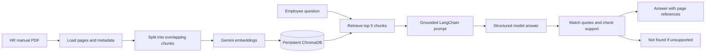
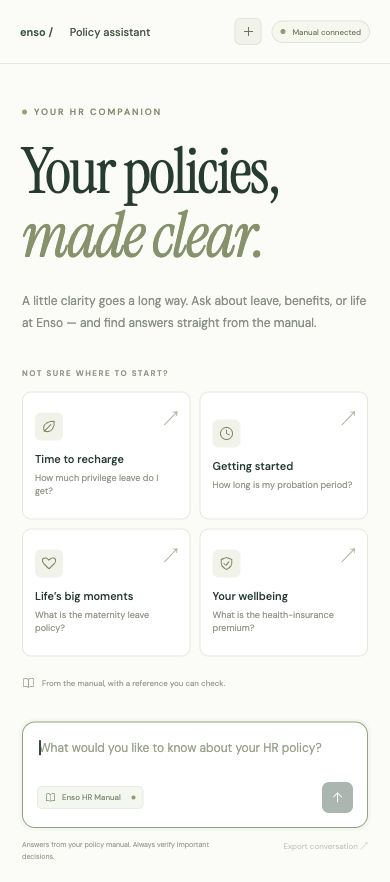

<div align="center">

# HR Policy Assistant

**Your policies, made clear.**

A document-grounded HR assistant with a local web interface, a terminal app, and policy references you can verify.

[](https://github.com/Harshsurana-hub/HR_Policy_Assistant/actions/workflows/tests.yml)


[Quick start](#quick-start) · [How it works](#how-it-works) · [Verified answers](#verified-assignment-answers) · [Screenshots](#terminal-evidence) · [Testing](#testing)

</div>


## What it does

Ask employee-policy questions in a responsive browser UI or the original CLI. The assistant retrieves passages from the **supplied 79-page Enso Group HR Policy Manual**, validates supporting evidence, and cites the relevant PDF pages. If the manual does not support an answer, the answer is exactly **`Not found`**.

| Experience | Included |
| --- | --- |
| Browser UI | Suggested questions, chat, manual viewer, clickable PDF references, session history, text export |
| CLI | Repeated questions, blank-input handling, clean exit |
| Grounding | Quote matching plus a separate answer-support check |
| Local index | 280 chunks with page metadata, reused between sessions |
| Verification | Six recorded live questions, genuine terminal captures, 14 offline regression tests |

This is a **local demo app**, not a hosted service. Both interfaces call the same Python RAG pipeline. Browser questions are not answered from a hardcoded list.

## Quick start

### 1. Get the code and install dependencies

Use **Python 3.12** (tested with 3.12.14), an internet connection, and a Gemini API key with available quota.

```sh
git clone https://github.com/Harshsurana-hub/HR_Policy_Assistant.git
cd HR_Policy_Assistant
python3.12 -m venv .venv
source .venv/bin/activate
python -m pip install -r requirements.txt
cp .env.example .env
```

<details>
<summary>Windows setup</summary>

```powershell
git clone https://github.com/Harshsurana-hub/HR_Policy_Assistant.git
cd HR_Policy_Assistant
py -3.12 -m venv .venv
.venv\Scripts\Activate.ps1
python -m pip install -r requirements.txt
Copy-Item .env.example .env
```

If PowerShell activation is restricted, run `.venv\Scripts\python.exe` directly instead of changing system policy.

</details>

### 2. Configure your key and source document

Open `.env` locally and fill in `GOOGLE_API_KEY`. The example file documents the settings:

```dotenv
GOOGLE_API_KEY=your_own_key_here
CHAT_MODEL=gemini-3.5-flash-lite
EMBEDDING_MODEL=models/gemini-embedding-001
```

Download the [exact HR manual linked in the assignment](https://www.ensogroup.com/wp-content/themes/ensogroup/assets/images/enso-images/hr_manual.pdf) and save it as **`hr_manual.pdf` in the project root**. The PDF, API key and generated database are excluded from Git.

### 3. Build the index once

```sh
python ingest.py
```

The script loads all pages, rejects unreadable pages that need OCR, splits text into 800-character chunks with 150-character overlap, and persists embeddings in ChromaDB. For the supplied manual: **79 readable pages → 280 chunks**.

Ingestion uses paced batches and retries transient rate limits, so allow several minutes. Re-run it when the PDF or embedding model changes. Startup checks the document hash and embedding configuration.

### 4. Launch the app

```sh
python web_app.py --open
```

The UI opens at **http://127.0.0.1:8766**. Keep the server running during the demo; press **Control-C** in its terminal to stop. The server accepts local connections only.

On the prepared Mac, double-click `Start_Web_Assistant.command`. After a fresh clone, make the launchers executable if needed:

```sh
chmod +x Start_Web_Assistant.command Start_Assistant.command Capture_Terminal_Answers.command
```

Prefer the terminal interface?

```sh
python main.py
```

Type `exit` to quit. Neither interface rebuilds the index for each question.

## How it works



1. **Load and index:** LangChain preserves each page's metadata; ChromaDB stores the chunks and embeddings locally.
2. **Retrieve:** The question is embedded and compared with the stored vectors to retrieve five relevant chunks.
3. **Generate:** PDF spacing and split-word artifacts are cleaned. A LangChain prompt instructs Gemini to answer only from those passages and return supporting quotations with chunk IDs.
4. **Validate:** Quotes must match retrieved text after formatting normalization. A separate structured check must confirm that the remaining quotes support the answer.
5. **Reference:** Page citations come from validated evidence metadata, converted to one-based PDF viewer pages. Similarity alone is not proof of support.

**Failure and fallback are different:** missing evidence returns `Not found`; API, connectivity or quota problems are displayed as errors. Model verification reduces unsupported claims but is not a formal guarantee.

## Verified assignment answers

These outcomes were produced by the running application and checked against the source. Printed and PDF viewer page numbers match on pages 42, 60 and 62.

| # | Assigned question | Verified outcome | Document reference |
| --- | --- | --- | --- |
| 1 | Permanent employee's annual Privilege Leave | **12 days per calendar year** | Page 60, [G] Leave Policy |
| 2 | Probation up to Senior Manager | **3 months from joining** | Page 42, [B] Probation Policy |
| 3 | Company's health-insurance premium | **`Not found`** | No supporting amount found |
| 4 | Current GST rate in India | **`Not found`** | No supporting rate found |
| 5 | Maternity-leave duration | **90 days with pay, as stated in the manual** | Page 62, [G] Leave Policy, Maternity Leave table |

**Source qualifications:** no leave is credited during probation. Probation confirmation depends on review, and the manual permits one extension no longer than the original period. The maternity passage specifies confirmed female staff with at least 80 days worked in the preceding 12 months. It describes 90 days as “12 weeks” and 45 days as “6 weeks”; these conversions are inconsistent. The assistant preserves the stated policy rather than silently correcting it or substituting current law.

GST is deliberately not answered from external tax knowledge. The document is the only policy source.

- [Copy-ready LMS answers](LMS_ANSWERS.md)
- [Actual recorded application responses](data/evaluation.json)
- [Executed checks and their limits](TEST_RESULTS.md)
- [Manual review notes](DOCUMENT_REVIEW.md)

## Interface gallery

<details>
<summary>Live browser answer with a clickable policy reference</summary>


</details>

<details>
<summary>Mobile layout</summary>



</details>

## Terminal evidence

These are genuine terminal screenshots supplied by the user from a successful run. The recorded JSON is from an earlier successful run, so wording can differ while outcomes and cited pages agree.

<details>
<summary>Q1 — Privilege Leave</summary>


</details>

<details>
<summary>Q2 — Probation period</summary>


</details>

<details>
<summary>Q3 — Health-insurance premium</summary>


</details>

<details>
<summary>Q4 — Current GST rate</summary>


</details>

<details>
<summary>Q5 — Maternity leave</summary>


</details>

To capture a new run on macOS, double-click `Capture_Terminal_Answers.command`. It pauses after each answer for a genuine screenshot.

## Testing

### Offline regression tests — no API key or quota required

```sh
python -m unittest -v test_assistant
```

**14 tests passed locally.** They check evidence rejection, invalid source IDs, PDF word breaks, exact fallback behavior, HTTP validation, secret-file exclusion, and the distinction between model failures and unsupported answers. Fixtures are fictional; they do not replace live policy verification. GitHub Actions runs the same suite on pushes and pull requests, without API secrets.

### Live document evaluation — uses Gemini quota

```sh
python evaluate.py
```

This asks the five assigned questions plus an unsupported Mars-travel-policy question, then writes actual outputs to `data/evaluation.json`. Inspect the output and cited pages before replacing submission results. Previous live tests confirmed persistence, the six question outcomes, and browser behavior. See [the test report](TEST_RESULTS.md) for what was actually executed.

## Repository map

```text
HR_Policy_Assistant/
├── web_app.py                      Local HTTP interface to the RAG pipeline
├── web/                            HTML, CSS and browser interactions
├── main.py                         Shared answer pipeline and terminal UI
├── ingest.py                       Explicit PDF ingestion and index rebuild
├── common.py                       Local configuration and embeddings
├── evaluate.py                     Live six-question evaluation
├── test_assistant.py               Offline regression tests
├── requirements.txt                Pinned direct dependencies
├── .env.example                    Secret-free configuration template
├── .github/workflows/tests.yml     Automated offline checks
├── Start_Web_Assistant.command     Mac web-app launcher
├── Start_Assistant.command         Mac CLI launcher
├── Capture_Terminal_Answers.command
├── data/evaluation.json            Recorded live answers
├── screenshots/                    UI previews and terminal evidence
├── LMS_ANSWERS.md
├── TEST_RESULTS.md
└── DOCUMENT_REVIEW.md
```

Local files excluded from Git: `.env`, `.venv/`, `hr_manual.pdf`, `chroma_db/` and `chroma_db_build/`.

## Troubleshooting

| Symptom | What to do |
| --- | --- |
| Missing database / setup incomplete | Activate the virtual environment, configure `.env`, add the PDF and run `python ingest.py`. |
| Invalid key / model request fails | Check the local key and network connection. Confirm the configured model is available to your account. |
| Gemini rate limit | Wait for quota availability. Minute and daily limits are different; repeated retries cannot fix an exhausted daily quota. |
| Embedding model or PDF changed | Re-run ingestion before asking questions. |
| Blank or scanned PDF pages | Obtain a readable or OCR-processed copy of the supplied manual. OCR is not included. |
| Port 8766 is in use | Open the existing app, stop its server, or run `python web_app.py --port 8767 --open`. |
| Mac launcher does not open | Apply the executable permissions above, or use `python web_app.py --open` directly. |
| A known passage returns `Not found` | Inspect retrieval and source extraction; do not replace the answer with a guessed value. |

## Scope and limitations

This is a beginner-friendly college RAG project, not a production HR decision system. The supplied manual can contain dated or inconsistent statements. Retrieval may miss relevant evidence, and LLM support checks can make mistakes. Verify important answers directly in the source PDF. The local app needs internet access and Gemini quota; browser conversations are kept only in the current session unless exported.

The manual, generated index and credentials are not distributed in the repository. There is no hosted backend, authentication system, OCR pipeline or guarantee of current statutory compliance.

## Contributing

See [CONTRIBUTING.md](CONTRIBUTING.md) for checks and the rules for grounded policy answers.
